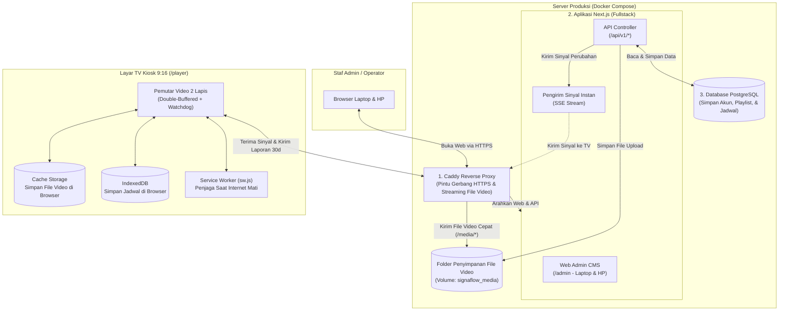

# 02. Technical Requirements Document (TRD) & Cara Kerja Sistem

Dokumen ini menjelaskan **bagaimana cara kerja mesin SignaFlow di balik layar**. Disusun dengan bahasa yang mudah dipahami, sehingga saat mulai ngoding kita langsung paham alur datanya.

---

## 1. Gambaran Besar Arsitektur Sistem

Secara sederhana, sistem kita terdiri dari **3 wadah (container) Docker** di sisi Server yang melayani **Browser Admin** dan **Browser TV Kiosk**:

> **Kenapa file video (`/media/*`) disajikan lewat Caddy, bukan lewat Node.js?**
> Bayangkan kamu punya video 100 MB dan ada 10 TV yang mengunduh bersamaan. Kalau lewat Node.js, aplikasi kita bisa lemot karena sibuk memproses transfer file besar. Dengan bantuan **Caddy**, urusan kirim file video ditangani langsung oleh Caddy yang sangat cepat dan hemat memori, sementara Node.js tetap fokus melayani API dan logika database.

---

## 2. Rahasia TV Tetap Berputar Walau Internet Mati (*Offline-First*)

Banyak orang heran: *"Kok bisa halaman web tetap memutar video dan ganti jadwal padahal kabel LAN atau Wi-Fi dicabut?"*
Jawabannya adalah gabungan **3 teknologi resmi bawaan browser** di halaman `/player`:

1. **`Service Worker (public/sw.js)` untuk Menyimpan Halaman Web:**
   Saat Kiosk pertama kali dibuka, Service Worker menyimpan seluruh kode tampilan web `/player` (HTML, CSS, JS) ke dalam memori komputer Kiosk. Jadi kalau TV mati lampu dan menyala kembali saat Wi-Fi masih mati, browser tidak akan menampilkan "No Internet", melainkan langsung membuka halaman `/player` dari memori lokal.
2. **`Cache Storage API` untuk Menyimpan File Video Besar:**
   Penyimpanan biasa (`localStorage`) cuma muat 5 MB (tidak muat untuk video). Nah, `Cache Storage` bawaan browser bisa menyimpan file video bergiga-giga byte langsung di dalam harddisk TV.
3. **`IndexedDB` untuk Menyimpan Data Jadwal:**
   Data jadwal tayang disimpan di database mini di dalam browser bernama `IndexedDB`. Setiap detik, Kiosk membaca jadwal dari sini tanpa perlu koneksi internet.

### Aturan Emas: Download Sampai Tuntas Dulu, Baru Ganti Jadwal
Bayangkan Admin menambahkan 3 video baru untuk jadwal siang. Di tengah proses download, Wi-Fi tiba-tiba putus saat video baru ter-download 2. Apa yang harus dilakukan TV Kiosk?
* **Salah:** Langsung memutar jadwal baru (layar akan gelap pas memutar video ke-3 yang belum ada).
* **Benar (Cara SignaFlow):** Kiosk **tetap memutar jadwal lama** yang videonya sudah lengkap di memori. Kiosk hanya akan beralih ke jadwal baru setelah **100% video baru selesai di-download dan lolos pengecekan SHA-256**. Begitu sudah 100%, barulah jadwal baru diputar dan video lama yang tidak terpakai dihapus dari memori.

---

## 3. Cara Mengatasi Jam TV yang Ngaco (*Clock Drift Mitigation*)

Masalah klasik di lapangan: Jam di PC TV sering meleset beberapa menit (misalnya karena baterai CMOS-nya lemah). Kalau jam di TV terlambat 10 menit, maka promo siang yang harusnya muncul jam 12:00 baru akan muncul jam 12:10.

**Cara mengatasinya sangat mudah:**
1. Setiap kali TV Kiosk melapor ke server (setiap 30 detik), server selalu menyertakan jam server saat itu (`serverTimestampMs`).
2. TV Kiosk menghitung selisih jamnya:
   `Selisih Jam = Jam Server - Jam Lokal TV`
3. Angka selisih jam ini disimpan di `IndexedDB`.
4. Saat mengecek jadwal tayang, TV Kiosk selalu menggunakan rumus:
   **`Jam Sekarang = Jam Lokal TV + Selisih Jam`**
   Hasilnya, seluruh TV di gedung akan berganti promo di detik yang sama persis!

---

## 4. Rahasia Transisi Video Tanpa Kedip Hitam (*Double-Buffered Player*)

Kalau kita cuma memakai 1 tag `<video>` di HTML lalu mengganti sumber videonya (`video.src = "promo2.mp4"`), layar TV pasti akan berkedip hitam sebentar (sekitar 0,5 detik) saat browser memuat video kedua. Di layar iklan profesional, kedipan hitam ini sangat mengganggu.

**Solusinya: Trik 2 Lapis Pemutar (Slot A dan Slot B):**
1. Saat **Slot A** tampil di depan memutar Video 1, **Slot B** bersembunyi di belakangnya (`opacity: 0`).
2. **3 detik sebelum Video 1 selesai**, Slot B diam-diam memuat Video 2 dari memori lokal dan bersiap di detik ke-0.
3. Begitu waktu Video 1 habis, Slot B langsung dimunculkan (`opacity: 1`) dan Slot A disembunyikan (`opacity: 0`).
4. Setelah Slot A bersembunyi, kita bersihkan memori video di Slot A agar RAM komputer tidak penuh, lalu giliran Slot A yang menyiapkan Video 3.

---

## 5. Satpam Pengaman Layar (*3-Tier Watchdog*)

Agar TV Kiosk aman ditinggal berbulan-bulan tanpa pengawasan:

1. **Layar Dikunci Rapi (`9:16`):**
   - Kursor mouse dihilangkan dengan CSS `cursor: none`.
   - Klik kanan, blok tulisan, dan zoom layar dimatikan lewat JavaScript.
   - **Fitur Auto-Scale untuk Laptop:** Kalau halaman `/player` dibuka di laptop developer (layar melebar `16:9`), ukurannya otomatis diskalakan di tengah layar sehingga kita tetap bisa melihat bentuk vertikal `9:16` tanpa terpotong.
2. **Watchdog (Satpam Otomatis 3 Lapis):**
   - **Satpam 1 (Deteksi Video Macet 5 Detik):** Kalau ada video yang macet detiknya selama 5 detik, sistem otomatis melompati video tersebut ke video berikutnya.
   - **Satpam 2 (Penangkap Error React):** Kalau terjadi error tak terduga, layar tetap hitam tenang (tidak menampilkan tulisan error kodingan di depan umum) lalu me-reset dirinya sendiri dalam 2 detik.
   - **Satpam 3 (Segarkan Memori Jam 03:30 Pagi):** Setiap jam 03:30 subuh saat gedung sepi, browser melakukan refresh halus agar penggunaan RAM komputer tetap segar.
3. **Menu Rahasia Operator:**
   Ketuk sudut kiri atas layar TV sebanyak **5 kali berturut-turut** untuk memunculkan kotak info tersembunyi (berisi nama Kiosk, status Wi-Fi, persentase download, dan tombol reset).
