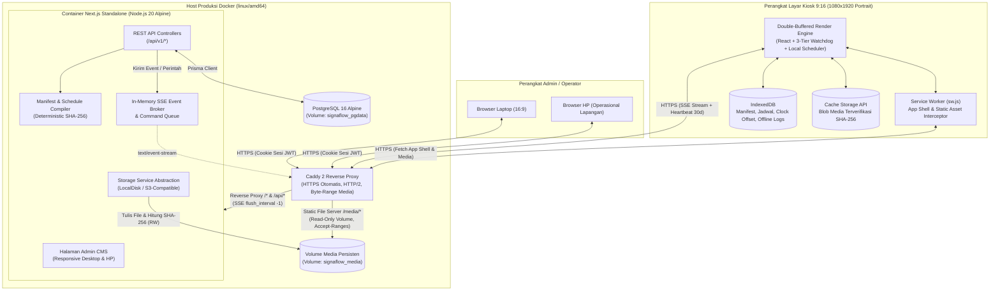
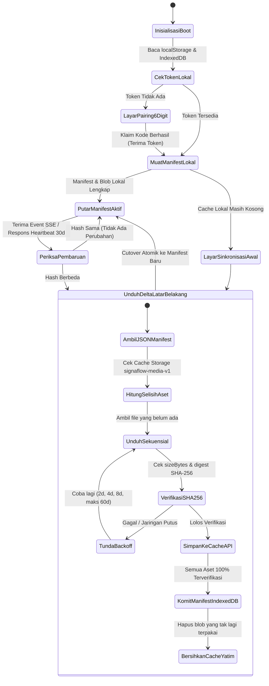

# 02. Technical Requirements Document (TRD) & Arsitektur Sistem

| Metadata Dokumen | Detail |
| :--- | :--- |
| **Sistem** | SignaFlow Digital Signage Platform |
| **Target Deployment** | Docker Compose (`linux/amd64`) dengan Caddy HTTPS Reverse Proxy |
| **Pola Arsitektur** | Modular Monolith (Next.js Standalone) + Offline-First Edge Player (PWA) |

---

## 1. Diagram Arsitektur Tingkat Tinggi



---

## 2. Protokol Sinkronisasi *Offline-First* & Transisi Atomik

### 2.1 Mengapa Transisi Atomik Wajib Diterapkan?
Jika admin memperbarui jadwal dengan 5 video promosi baru dan koneksi Wi-Fi kiosk terputus saat baru selesai mengunduh 2 video, kiosk **tidak boleh** langsung memutar jadwal baru tersebut. Jika dipaksakan, 3 video sisanya akan gagal dimuat dan menyebabkan layar gelap.

Oleh karena itu, SignaFlow menerapkan protokol **Atomic Manifest Cutover**:
1. Saat *manifest* baru terdeteksi (`remoteManifestHash !== localManifestHash`), kiosk **tetap memutar *manifest* lama** yang sudah lengkap di lokal.
2. Di latar belakang, *Sync Worker* membandingkan daftar `requiredAssets` pada *manifest* baru dengan isi `Cache Storage` (`signaflow-media-v1`).
3. Hanya aset yang **belum ada** di `Cache Storage` yang diunduh (*delta sync*) satu per satu secara berurutan.
4. Setiap aset yang diunduh diverifikasi ukuran *byte*-nya (`sizeBytes`) dan *hash* `SHA-256`-nya menggunakan `crypto.subtle.digest('SHA-256', arrayBuffer)`.
5. Setelah **100%** aset dalam `requiredAssets` terverifikasi tersimpan di `Cache Storage`, barulah dokumen *manifest* baru disimpan ke `IndexedDB` sebagai *active manifest*, diikuti penghapusan aset lama yang sudah tidak direferensikan lagi (*orphan garbage collection*).

### 2.2 Diagram State Machine Sinkronisasi Kiosk



---

## 3. Algoritma Mitigasi Pergeseran Jam (*Clock Drift Mitigation*)

Kiosk fisik yang beroperasi tanpa henti sering mengalami ketidakakuratan jam sistem (misalnya baterai CMOS lemah atau tidak mendapat akses ke server NTP internet publik). Agar pergantian jadwal *day-parting* (contoh: tepat pukul `12:00:00`) tetap akurat:

1. Setiap kali kiosk memanggil endpoint `/api/v1/device/manifest` atau `/api/v1/device/heartbeat`, kiosk mencatat waktu kirim monontonik `t0 = performance.now()` dan waktu penerimaannya `t1 = performance.now()`.
2. Server selalu menyertakan `serverTimestampMs` (waktu UTC server dalam milidetik).
3. Kiosk menghitung estimasi waktu server saat respons tiba:
   $$\text{RTT} = t_1 - t_0$$
   $$\text{EstimatedServerTime} = \text{serverTimestampMs} + \frac{\text{RTT}}{2}$$
   $$\text{SampleOffset} = \text{EstimatedServerTime} - \text{Date.now()}$$
4. Kiosk menyimpan 5 nilai `SampleOffset` terakhir dan mengambil **nilai median** sebagai `clockOffsetMs`, lalu menyimpannya ke `IndexedDB` agar tetap bertahan meskipun kiosk melakukan *reboot* dalam kondisi *offline*.
5. Seluruh pengecekan jadwal di sisi kiosk menggunakan fungsi waktu terkoreksi:
   ```typescript
   export function getCorrectedNowMs(clockOffsetMs: number): number {
     return Date.now() + clockOffsetMs;
   }
   ```

---

## 4. Pipeline *Double-Buffered Rendering* (Transisi Tanpa Kedip)

Pada *browser* standar, mengganti atribut `src` pada satu elemen `<video>` akan menyebabkan layar berkedip hitam selama `200ms - 800ms` sementara *decoder* membuka *stream* baru. Untuk mencapai **Zero-Flicker Transition (`< 16ms`)**, pemutar kiosk menggunakan arsitektur **Dua Lapisan DOM (Slot A dan Slot B)**:

* **Kondisi Saat Ini:** Slot A sedang menampilkan item `index = 0` (`opacity: 1; z-index: 20`). Slot B berada di belakangnya (`opacity: 0; z-index: 10`).
* **Tahap Pre-Decode (`T - 3 detik` sebelum item 0 selesai):**
  - Pemutar mengambil *Blob* media untuk item `index = 1` dari `Cache Storage` dan membuat Object URL (`URL.createObjectURL(blob)`).
  - Slot B memuat Object URL tersebut (`preload="auto"` untuk video atau `img.decode()` untuk gambar) dalam kondisi masih tersembunyi (`opacity: 0`).
* **Tahap Cutover (`T = 0`):**
  - Saat waktu tayang item `0` habis, pemutar memanggil `slotBVideo.play()` dan secara serentak menukar kelas CSS antara Slot A dan Slot B (dengan `transition: opacity 400ms ease` untuk `CROSSFADE`, atau `transition: none` untuk `CUT`).
* **Tahap Pembersihan Memori (`T + 500ms`):**
  - Setelah Slot A tersembunyi sepenuhnya, pemutar menghentikan video di Slot A, melepaskan *decoder buffer* GPU (`video.pause(); video.removeAttribute('src'); video.load();`), dan memanggil `URL.revokeObjectURL(oldBlobUrl)` agar penggunaan RAM tetap rata selama berbulan-bulan.

---

## 5. Strategi Penguncian Kiosk (*Kiosk Hardening*) & *3-Tier Watchdog*

### 5.1 Penguncian Viewport & Gestur
* **Resolusi Target:** `1080x1920` piksel (`aspect-ratio: 9 / 16`).
* **Mode Pratinjau Otomatis (Laptop/HP):** Jika halaman `/player` dibuka pada layar yang bukan `1080x1920` (misalnya layar laptop *developer* `1920x1080` atau layar HP), kontainer pembungkus otomatis menghitung faktor skala CSS:
  $$\text{scale} = \min\left(\frac{\text{window.innerWidth}}{1080}, \frac{\text{window.innerHeight}}{1920}\right)$$
  sehingga kanvas `1080x1920` tetap tampil utuh dan presisi di tengah layar tanpa *scrollbar*.
* **Pemblokiran Interaksi Liar:**
  - `cursor: none !important` (menyembunyikan kursor *mouse*).
  - Mematikan *event* `contextmenu` (klik kanan), `selectstart` (seleksi teks), `dragstart`, serta gestur *pinch-to-zoom* (`touchmove` dengan lebih dari 1 jari).
  - Tombol rahasia untuk operator di lapangan: Mengetuk sudut kiri atas layar sebanyak **5 kali dalam 3 detik** akan membuka *Overlay Diagnostik Kiosk* (menampilkan status koneksi, IP, *hash manifest*, jumlah aset di *cache*, dan tombol *Force Sync* lokal).

### 5.2 Arsitektur Pemulihan Mandiri (*3-Tier Watchdog*)
1. **Tier 1 - Item Stall Watchdog (Deteksi Macet 5 Detik):**
   *Loop* pengawas memeriksa setiap 1 detik apakah elemen `<video>` aktif mengalami kemacetan (`currentTime` tidak bergerak selama 5 detik padahal video tidak sedang di-*pause*). Jika terdeteksi macet atau *file* rusak (`onError`), pemutar otomatis melompati item tersebut ke item berikutnya dan mencatat log `PLAYBACK_ERROR`.
2. **Tier 2 - React Error Boundary:**
   Membungkus seluruh komponen `/player`. Jika terjadi *runtime exception* pada komponen React, *Error Boundary* menahan layar tetap berwarna hitam polos (tidak pernah membocorkan pesan *error* teknis ke pengunjung) dan memulihkan ulang *state* pemutar dalam 2 detik.
3. **Tier 3 - Daily Soft-Reload Terjadwal (03:30 Pagi):**
   Setiap pukul `03:30:00` dini hari waktu lokal, pemutar memeriksa apakah *Service Worker* aktif dan *cache* lengkap. Jika aman, pemutar memanggil `window.location.reload()` untuk membersihkan *heap* memori *browser* Chromium secara berkala.
