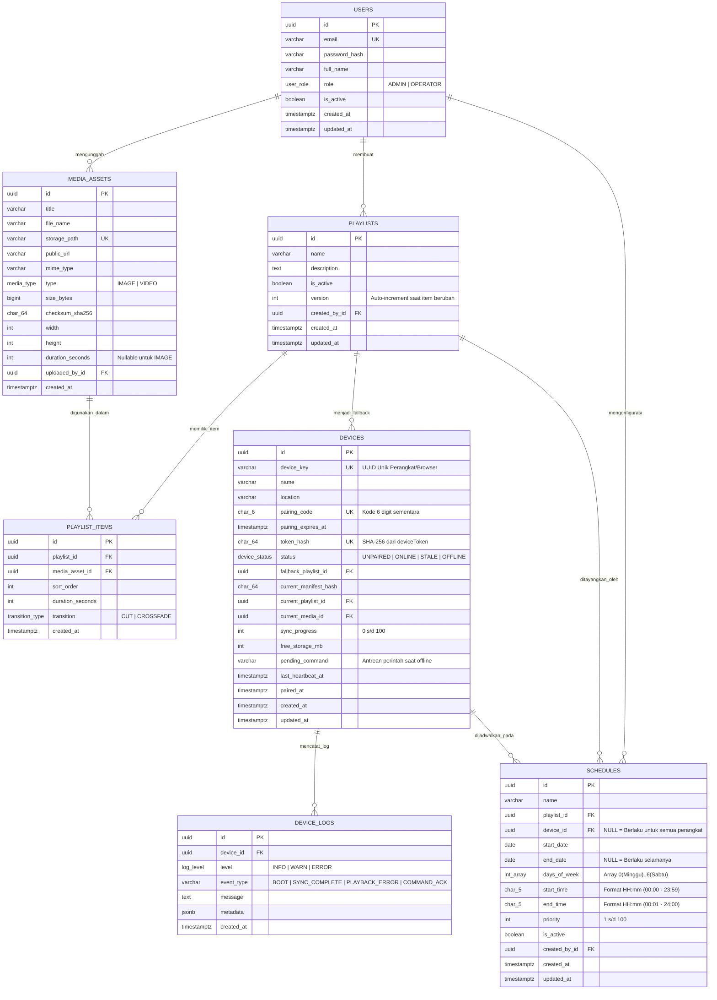

# 04. ERD & Spesifikasi Skema Database

| Metadata Dokumen | Detail |
| :--- | :--- |
| **DBMS** | PostgreSQL 16 (Alpine) |
| **ORM** | Prisma ORM |
| **Tingkat Normalisasi** | Third Normal Form (3NF) |

---

## 1. Entity Relationship Diagram (ERD)



---

## 2. Kamus Data & Kebijakan Relasi (*Foreign Key Policies*)

| Tabel | Relasi Kunci Asing (*Foreign Key*) | Kebijakan `ON DELETE` | Alasan Teknis |
| :--- | :--- | :--- | :--- |
| `playlist_items` | `playlist_id -> playlists.id` | `CASCADE` | Jika sebuah *playlist* dihapus, seluruh baris urutan item di dalamnya ikut terhapus otomatis. |
| `playlist_items` | `media_asset_id -> media_assets.id` | **`RESTRICT`** | **Sangat Penting:** Mencegah admin menghapus file video/gambar yang masih terdaftar di dalam *playlist*. Menghindari *broken link* pada layar kiosk. |
| `devices` | `fallback_playlist_id -> playlists.id` | `SET NULL` | Jika *fallback playlist* dihapus, perangkat tetap terdaftar namun `fallback_playlist_id` diatur menjadi `NULL`. |
| `schedules` | `playlist_id -> playlists.id` | `CASCADE` | Jika *playlist* dihapus, jadwal yang menayangkan *playlist* tersebut ikut dibersihkan. |
| `schedules` | `device_id -> devices.id` | `CASCADE` | Jika sebuah perangkat kiosk dihapus, jadwal khusus untuk perangkat tersebut ikut terhapus. |
| `device_logs` | `device_id -> devices.id` | `CASCADE` | Jika perangkat dihapus, riwayat log telemetrinya ikut dibersihkan. |

---

## 3. Spesifikasi Skema Prisma (`prisma/schema.prisma`)

Berikut adalah skema Prisma siap pakai yang menjadi acuan migrasi pada Fase 1:

```prisma
generator client {
  provider = "prisma-client-js"
}

datasource db {
  provider = "postgresql"
  url      = env("DATABASE_URL")
}

enum UserRole {
  ADMIN
  OPERATOR
}

enum DeviceStatus {
  UNPAIRED
  ONLINE
  STALE
  OFFLINE
}

enum MediaType {
  IMAGE
  VIDEO
}

enum TransitionType {
  CUT
  CROSSFADE
}

enum LogLevel {
  INFO
  WARN
  ERROR
}

model User {
  id           String       @id @default(uuid()) @db.Uuid
  email        String       @unique @db.VarChar(255)
  passwordHash String       @map("password_hash") @db.VarChar(255)
  fullName     String       @map("full_name") @db.VarChar(120)
  role         UserRole     @default(ADMIN)
  isActive     Boolean      @default(true) @map("is_active")
  createdAt    DateTime     @default(now()) @map("created_at") @db.Timestamptz(6)
  updatedAt    DateTime     @updatedAt @map("updated_at") @db.Timestamptz(6)

  mediaAssets  MediaAsset[]
  playlists    Playlist[]
  schedules    Schedule[]

  @@map("users")
}

model MediaAsset {
  id              String         @id @default(uuid()) @db.Uuid
  title           String         @db.VarChar(160)
  fileName        String         @map("file_name") @db.VarChar(255)
  storagePath     String         @unique @map("storage_path") @db.VarChar(512)
  publicUrl       String         @map("public_url") @db.VarChar(512)
  mimeType        String         @map("mime_type") @db.VarChar(80)
  type            MediaType
  sizeBytes       BigInt         @map("size_bytes")
  checksumSha256  String         @map("checksum_sha256") @db.Char(64)
  width           Int            @default(1080)
  height          Int            @default(1920)
  durationSeconds Int?           @map("duration_seconds")
  uploadedById    String?        @map("uploaded_by_id") @db.Uuid
  createdAt       DateTime       @default(now()) @map("created_at") @db.Timestamptz(6)

  uploadedBy      User?          @relation(fields: [uploadedById], references: [id], onDelete: SetNull)
  playlistItems   PlaylistItem[]
  playingDevices  Device[]       @relation("CurrentPlayingMedia")

  @@index([type], map: "idx_media_assets_type")
  @@index([checksumSha256], map: "idx_media_assets_checksum")
  @@index([createdAt(sort: Desc)], map: "idx_media_assets_created_at")
  @@map("media_assets")
}

model Playlist {
  id                String         @id @default(uuid()) @db.Uuid
  name              String         @db.VarChar(140)
  description       String?        @db.Text
  isActive          Boolean        @default(true) @map("is_active")
  version           Int            @default(1)
  createdById       String?        @map("created_by_id") @db.Uuid
  createdAt         DateTime       @default(now()) @map("created_at") @db.Timestamptz(6)
  updatedAt         DateTime       @updatedAt @map("updated_at") @db.Timestamptz(6)

  createdBy         User?          @relation(fields: [createdById], references: [id], onDelete: SetNull)
  items             PlaylistItem[]
  schedules         Schedule[]
  fallbackForDevice Device[]       @relation("DeviceFallbackPlaylist")
  playingOnDevices  Device[]       @relation("CurrentPlayingPlaylist")

  @@map("playlists")
}

model PlaylistItem {
  id              String         @id @default(uuid()) @db.Uuid
  playlistId      String         @map("playlist_id") @db.Uuid
  mediaAssetId    String         @map("media_asset_id") @db.Uuid
  sortOrder       Int            @map("sort_order")
  durationSeconds Int            @default(10) @map("duration_seconds")
  transition      TransitionType @default(CROSSFADE)
  createdAt       DateTime       @default(now()) @map("created_at") @db.Timestamptz(6)

  playlist        Playlist       @relation(fields: [playlistId], references: [id], onDelete: Cascade)
  mediaAsset      MediaAsset     @relation(fields: [mediaAssetId], references: [id], onDelete: Restrict)

  @@unique([playlistId, sortOrder], map: "uq_playlist_item_order")
  @@index([playlistId, sortOrder(sort: Asc)], map: "idx_playlist_items_playlist_sort")
  @@index([mediaAssetId], map: "idx_playlist_items_media_asset")
  @@map("playlist_items")
}

model Device {
  id                  String       @id @default(uuid()) @db.Uuid
  deviceKey           String       @unique @map("device_key") @db.VarChar(128)
  name                String       @default("Unpaired Kiosk") @db.VarChar(120)
  location            String?      @db.VarChar(160)
  pairingCode         String?      @unique @map("pairing_code") @db.Char(6)
  pairingExpiresAt    DateTime?    @map("pairing_expires_at") @db.Timestamptz(6)
  tokenHash           String?      @unique @map("token_hash") @db.Char(64)
  status              DeviceStatus @default(UNPAIRED)
  fallbackPlaylistId  String?      @map("fallback_playlist_id") @db.Uuid
  currentManifestHash String?      @map("current_manifest_hash") @db.Char(64)
  currentPlaylistId   String?      @map("current_playlist_id") @db.Uuid
  currentMediaId      String?      @map("current_media_id") @db.Uuid
  syncProgress        Int          @default(0) @map("sync_progress")
  freeStorageMb       Int?         @map("free_storage_mb")
  pendingCommand      String?      @map("pending_command") @db.VarChar(64)
  lastHeartbeatAt     DateTime?    @map("last_heartbeat_at") @db.Timestamptz(6)
  pairedAt            DateTime?    @map("paired_at") @db.Timestamptz(6)
  createdAt           DateTime     @default(now()) @map("created_at") @db.Timestamptz(6)
  updatedAt           DateTime     @updatedAt @map("updated_at") @db.Timestamptz(6)

  fallbackPlaylist    Playlist?    @relation("DeviceFallbackPlaylist", fields: [fallbackPlaylistId], references: [id], onDelete: SetNull)
  currentPlaylist     Playlist?    @relation("CurrentPlayingPlaylist", fields: [currentPlaylistId], references: [id], onDelete: SetNull)
  currentMedia        MediaAsset?  @relation("CurrentPlayingMedia", fields: [currentMediaId], references: [id], onDelete: SetNull)
  schedules           Schedule[]
  logs                DeviceLog[]

  @@index([status, lastHeartbeatAt], map: "idx_devices_status_heartbeat")
  @@map("devices")
}

model Schedule {
  id          String    @id @default(uuid()) @db.Uuid
  name        String    @db.VarChar(160)
  playlistId  String    @map("playlist_id") @db.Uuid
  deviceId    String?   @map("device_id") @db.Uuid
  startDate   DateTime  @map("start_date") @db.Date
  endDate     DateTime? @map("end_date") @db.Date
  daysOfWeek  Int[]     @default([0, 1, 2, 3, 4, 5, 6]) @map("days_of_week")
  startTime   String    @map("start_time") @db.Char(5)
  endTime     String    @map("end_time") @db.Char(5)
  priority    Int       @default(10)
  isActive    Boolean   @default(true) @map("is_active")
  createdById String?   @map("created_by_id") @db.Uuid
  createdAt   DateTime  @default(now()) @map("created_at") @db.Timestamptz(6)
  updatedAt   DateTime  @updatedAt @map("updated_at") @db.Timestamptz(6)

  playlist    Playlist  @relation(fields: [playlistId], references: [id], onDelete: Cascade)
  device      Device?   @relation(fields: [deviceId], references: [id], onDelete: Cascade)
  createdBy   User?     @relation(fields: [createdById], references: [id], onDelete: SetNull)

  @@index([isActive, deviceId, startDate, endDate, priority(sort: Desc)], map: "idx_schedules_lookup")
  @@index([playlistId], map: "idx_schedules_playlist")
  @@map("schedules")
}

model DeviceLog {
  id        String   @id @default(uuid()) @db.Uuid
  deviceId  String   @map("device_id") @db.Uuid
  level     LogLevel @default(INFO)
  eventType String   @map("event_type") @db.VarChar(64)
  message   String   @db.Text
  metadata  Json     @default("{}") @db.JsonB
  createdAt DateTime @default(now()) @map("created_at") @db.Timestamptz(6)

  device    Device   @relation(fields: [deviceId], references: [id], onDelete: Cascade)

  @@index([deviceId, createdAt(sort: Desc)], map: "idx_device_logs_device_time")
  @@index([level, createdAt(sort: Desc)], map: "idx_device_logs_level_time")
  @@map("device_logs")
}
```

---

## 4. Strategi Indeks & Pemeliharaan Data

1. **Kompilasi Manifest Cepat (`idx_schedules_lookup`):** Indeks komposit `(is_active, device_id, start_date, end_date, priority DESC)` memastikan *query* pencarian jadwal untuk sebuah kiosk berjalan menggunakan *Index Scan* dalam `< 2ms`.
2. **Otentikasi Kiosk (`token_hash` UNIQUE):** Kolom `token_hash` memiliki indeks unik B-Tree sehingga validasi `Bearer <deviceToken>` pada setiap *heartbeat* 30 detik memiliki kompleksitas $O(\log N)$.
3. **Retensi Log Otomatis (`device_logs`):** Karena kiosk beroperasi 24/7, tabel `device_logs` dipangkas secara berkala (menyimpan maksimal 1.000 baris terbaru per perangkat atau menghapus log `INFO` yang berusia lebih dari 14 hari) agar ukuran disk database tetap ramping.
